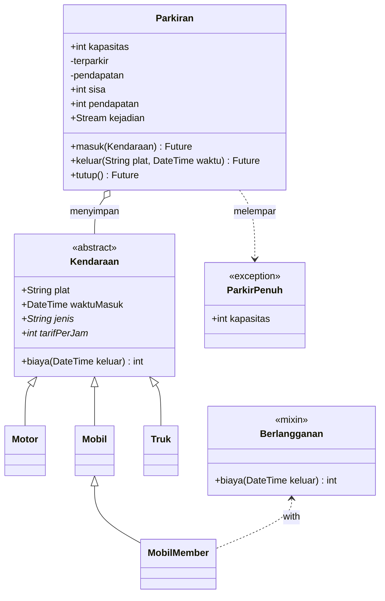
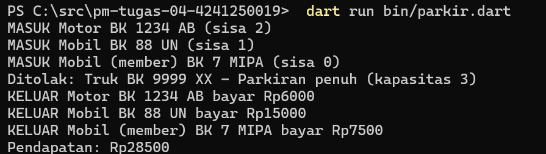

# Tugas Rutin 4 - Sistem Parkir Kampus (Console)

**Nama:** Siti Haliza Zamili
**NIM:** 4241250019
**Kelas:** PSIK 24D

## Deskripsi
Program console Dart untuk mengelola parkiran area kampus FMIPA. Kendaraan masuk dan
keluar melalui palang otomatis (disimulasikan dengan `Future.delayed`), biaya dihitung
per jam sesuai jenis kendaraan, dan setiap kejadian dipancarkan sebagai `Stream` untuk
ditampilkan di layar pos jaga. Saat parkiran penuh, kendaraan ditolak dengan exception
kustom `ParkirPenuh`.

## Struktur Proyek
```
lib/kendaraan.dart   -> Kendaraan (abstract), Motor, Mobil, Truk, mixin Berlangganan, MobilMember
lib/parkiran.dart    -> Parkiran, ParkirPenuh
bin/parkir.dart      -> program utama (demo)
```

## Cara Menjalankan
```
dart run bin/parkir.dart
```

## Diagram Kelas


## Tangkapan Layar
Keluaran program: tiga kendaraan masuk, truk ditolak karena parkiran penuh, lalu
ketiganya keluar dengan biaya masing-masing dan total pendapatan.



## Penjelasan
Enkapsulasi saya terapkan di kelas `Parkiran` (`lib/parkiran.dart`). Data `_terparkir`, `_pendapatan`, dan `_kejadian` diberi awalan garis bawah sehingga privat terhadap berkas dan tidak bisa diubah dari `main`. Dari luar, data hanya dibaca lewat getter `sisa` dan `pendapatan`.

Polimorfisme ada pada method `biaya` di kelas abstrak `Kendaraan`. `Motor`, `Mobil`, dan `Truk` menimpa `tarifPerJam`, sedangkan `MobilMember` memakai mixin `Berlangganan` yang menimpa `biaya` dengan diskon 50%. Di `main`, semua kendaraan disimpan dalam satu `List<Kendaraan>`, tetapi saat `biaya` dipanggil, Dart menjalankan versi milik objek aslinya.

Async dipakai pada `masuk` dan `keluar` yang mengembalikan `Future` dan menunggu `Future.delayed` untuk mensimulasikan palang, lalu dipanggil dengan `await` di `main`. Setiap kejadian dikirim lewat `StreamController.broadcast()` dan ditampilkan oleh `listen`. Karena event Stream sampai secara asinkron, `tutup()` saya panggil sebelum mencetak pendapatan supaya urutan keluarannya benar.

## Pernyataan Penggunaan AI
Saya menggunakan Claude (Anthropic) selama mengerjakan tugas ini.

**Dibantu AI:**
- Penjelasan materi Pertemuan 4 (modul dan slide).
- Kode `lib/kendaraan.dart`, `lib/parkiran.dart`, dan `bin/parkir.dart`.
- Langkah Git, kerangka README, dan diagram kelas.
- Draf bagian Penjelasan (saya baca, pahami, dan sesuaikan).

**Saya kerjakan sendiri:**
- Membuat proyek, menjalankan program, dan menguji keluarannya.
- Mengambil tangkapan layar, menjalankan `dart format` dan `dart analyze`.
- Analisis penyebab urutan keluaran yang terbalik dan perbaikannya.
- Membuat repository GitHub, commit, dan push.
